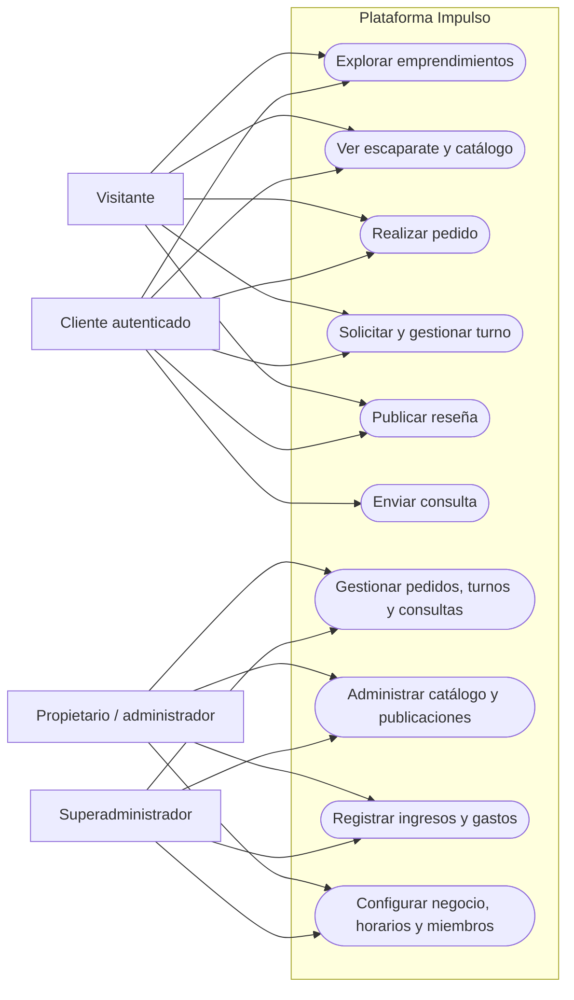
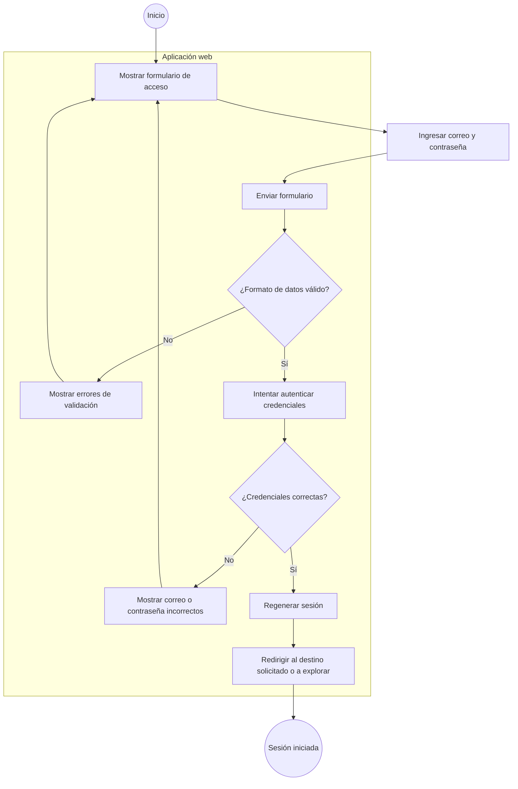
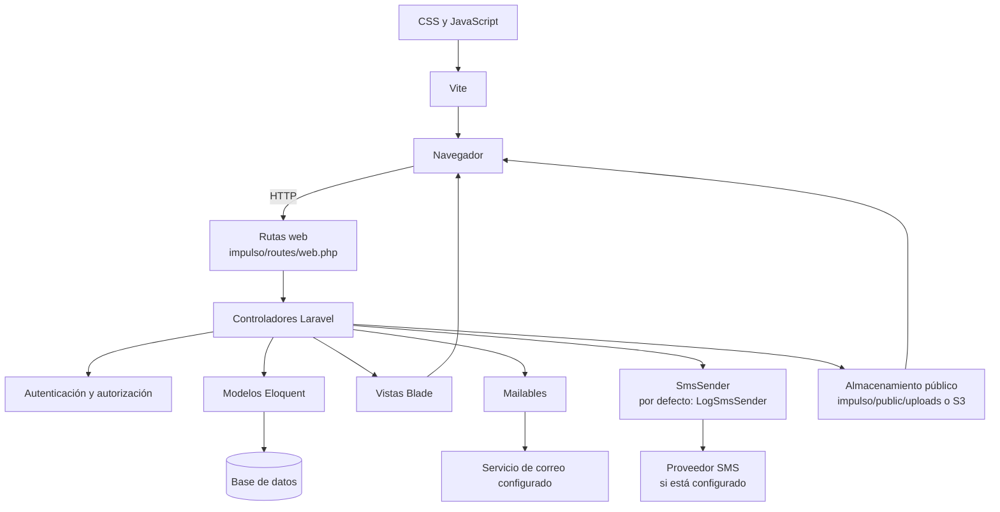
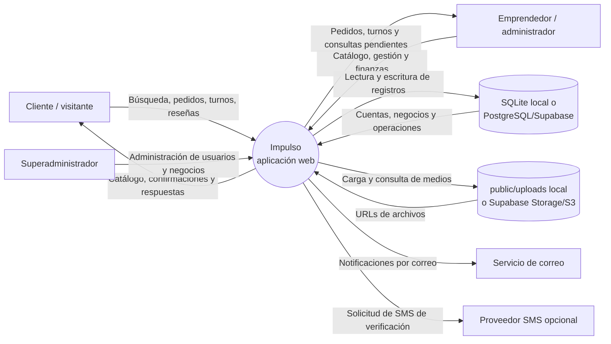
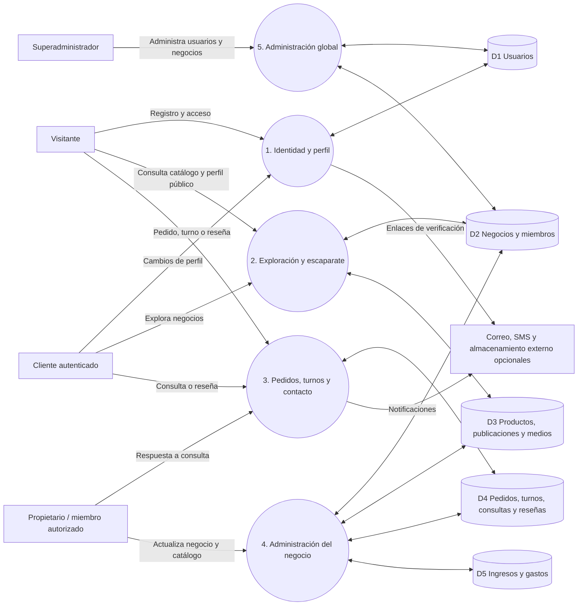
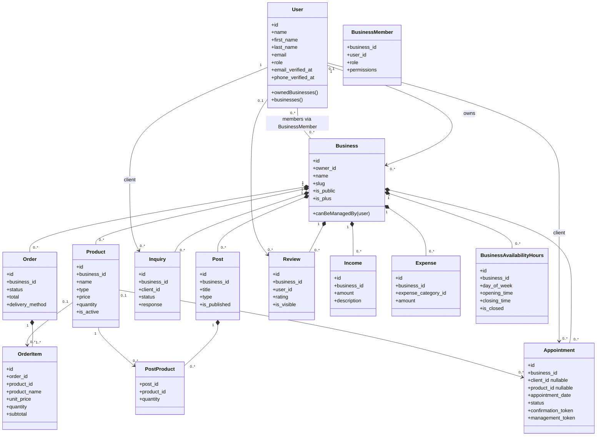
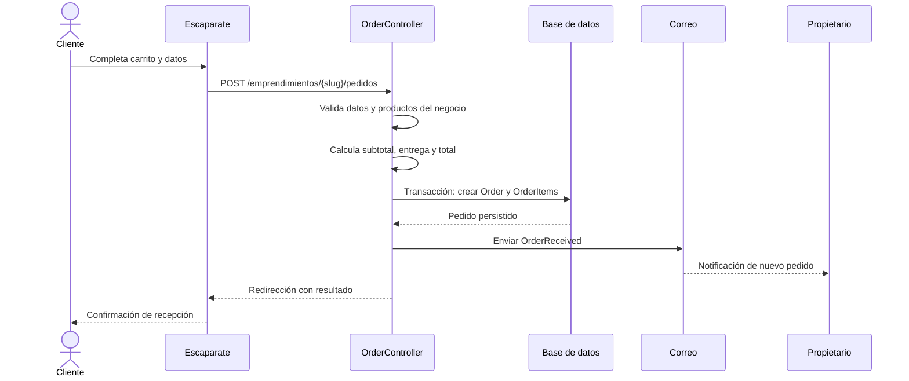
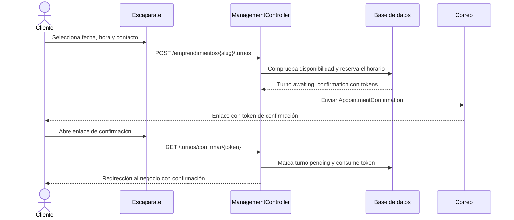

# Arquitectura de Impulso

> Documento técnico del sistema. Los diagramas describen el comportamiento y las relaciones implementadas actualmente; no representan funcionalidades futuras.

## 1. Propósito y alcance

Impulso es una aplicación web multiemprendimiento. Cada negocio dispone de una página pública para presentar su catálogo, publicaciones y formas de contacto, y de un panel privado para operar el negocio. Los clientes pueden explorar la oferta, iniciar pedidos, solicitar turnos y, cuando inician sesión, enviar consultas o reseñas. La versión actual incluye perfiles con verificación de correo/teléfono, administración de usuarios y negocios, publicaciones vinculadas a productos y una página de vista previa de +Impulso.

La aplicación está construida como un monolito Laravel: las rutas web coordinan controladores, los modelos Eloquent representan el dominio persistido y las vistas Blade entregan las páginas. Vite compila los recursos de interfaz. El repositorio incluye una entrada PHP y configuración para Vercel; la persistencia compartida con PostgreSQL y el almacenamiento S3 compatible son opciones que deben configurarse por entorno.

## 2. Actores y permisos

| Actor | Capacidades principales |
| --- | --- |
| Visitante | Explorar negocios, consultar catálogos, solicitar un turno como invitado y publicar una reseña. |
| Cliente autenticado | Enviar consultas y reseñas; puede solicitar turnos asociado a su cuenta. |
| Propietario o administrador del negocio | Gestionar el panel, catálogo, publicaciones, operaciones y miembros del negocio. |
| Superadministrador | Puede gestionar los negocios a través de la regla central de autorización del modelo `Business`. |

Las rutas del panel exigen autenticación. Las operaciones de gestión verifican que el usuario sea propietario, superadministrador o miembro con rol `owner` o `administrator`. La elegibilidad se centraliza en `Business::canBeManagedBy()`.

### Diagrama de casos de uso



### Diagrama de actividad UML: inicio de sesión

El flujo refleja `AuthController::login`: la petición valida correo y contraseña, intenta autenticar, vuelve al formulario con un error ante credenciales inválidas y regenera la sesión cuando el acceso es correcto.



## 3. Componentes y responsabilidades

| Componente | Responsabilidad |
| --- | --- |
| `impulso/routes/web.php` | Define páginas públicas, autenticación y operaciones del panel. |
| Controladores HTTP | Validan solicitudes, aplican reglas del caso de uso y coordinan modelos, correo y respuestas. |
| Modelos Eloquent | Representan negocios, cuentas, catálogo, pedidos, turnos y registros administrativos. |
| Migraciones | Mantienen versionado el esquema y sus claves foráneas. |
| Vistas Blade | Renderizan páginas públicas, formularios y paneles. |
| Mailables | Envían confirmaciones de turno y avisos de pedido. |
| Vite | Compila estilos y recursos JavaScript para desarrollo y producción. |

### Diagrama de componentes



### Diagrama de flujo de datos (DFD): contexto

Los rectángulos representan entidades externas, el proceso central representa la aplicación y los cilindros son almacenes persistentes. PostgreSQL/Supabase y S3 son opciones de entorno; SQLite y el disco local son los valores locales de referencia.



### DFD: procesos y almacenes principales



### EDT funcional del producto

La EDT resume los entregables funcionales que existen en el repositorio; no es un cronograma ni asigna responsables.

```mermaid
flowchart TB
    root["Impulso"]
    root --> access["1. Identidad y acceso"]
    root --> discovery["2. Descubrimiento público"]
    root --> commerce["3. Interacciones comerciales"]
    root --> operations["4. Operación del emprendimiento"]
    root --> platform["5. Plataforma e integraciones"]
    root --> quality["6. Calidad y documentación"]

    access --> accounts["Registro, login y sesión"]
    access --> profiles["Perfil y preferencias"]
    access --> verification["Verificación de correo y teléfono"]
    access --> roles["Roles de negocio y administración"]
    discovery --> search["Explorar negocios"]
    discovery --> storefront["Escaparate y personalización"]
    discovery --> catalog["Productos y publicaciones"]
    commerce --> orders["Pedidos y entregas"]
    commerce --> appointments["Turnos y disponibilidad"]
    commerce --> communication["Consultas y reseñas"]
    operations --> inventory["Inventario y base de datos del negocio"]
    operations --> finance["Ingresos y gastos"]
    operations --> team["Miembros y permisos"]
    platform --> persistence["SQLite / PostgreSQL y migraciones"]
    platform --> media["Archivos locales / almacenamiento S3"]
    platform --> notifications["Correo y adaptador SMS"]
    platform --> deployment["Entrada y configuración Vercel"]
    quality --> tests["Pruebas Feature y Unit"]
    quality --> manuals["Manuales y diagramas técnicos"]
```



## 4. Modelo de dominio

Un `Business` pertenece a un usuario propietario y tiene colecciones de catálogo, pedidos, turnos y otros registros. Los miembros se relacionan mediante `business_members`, que almacena rol y permisos. Un pedido puede tener varios `OrderItem`; cada renglón conserva el nombre y precio unitario del producto al momento de compra. Un producto también puede asociarse a pedidos y turnos.

Los turnos admiten `client_id` nulo para clientes invitados; la confirmación y administración de esos turnos se hace mediante tokens enviados en enlaces. Las consultas requieren un usuario autenticado. Los registros financieros se mantienen separados: `Income` y `Expense` pertenecen al negocio.

### Diagrama de clases y relaciones



## 5. Flujos principales

### Pedido desde el escaparate

El cliente envía datos de contacto, entrega/retiro, pago y productos. El servidor valida que los productos estén activos y pertenezcan al negocio, calcula los importes a partir de precios leídos desde la base de datos y crea pedido e ítems dentro de una transacción. Luego envía un correo al propietario. El negocio actualiza el estado desde su panel.

### Diagrama de secuencia: pedido



### Diagrama de secuencia: turno de invitado



## 6. Rutas por área

Las rutas están declaradas en `impulso/routes/web.php` y siguen esta organización:

| Área | Rutas representativas | Acceso |
| --- | --- | --- |
| Inicio y exploración | `/`, `/explorar` | Público |
| Escaparate | `/emprendimientos/{slug}` | Público |
| Pedidos | `/emprendimientos/{slug}/pedidos` | Público |
| Turnos | `/emprendimientos/{slug}/turnos`, `/turnos/confirmar/{token}` | Público, sujeto a disponibilidad |
| Cuenta | `/ingresar`, `/registrarse`, `/salir` | Invitado / autenticado |
| Perfil y verificación | `/mi-perfil`, `/mi-perfil/verificar-correo`, `/mi-perfil/verificar-telefono` | Autenticado; envíos con límite de frecuencia |
| Panel | `/panel/{slug}` y subrutas | Autenticado y autorizado para el negocio |
| Administración global | `/administracion/usuarios`, `/administracion/emprendimientos` | Autenticado; solo rol `superadmin` |
| +Impulso | `/impulso-plus`, `/panel/{slug}/impulso-plus` | Autenticado y autorizado; vista previa sin cobros |
| Bandeja | `/bandeja` | Autenticado |
| Consultas | `/emprendimientos/{slug}/consultas` | Cliente autenticado |
| Reseñas | `/emprendimientos/{slug}/reseñas` | Público; la cuenta se asocia cuando hay una sesión autenticada |

## 7. Persistencia y datos

El esquema evoluciona con migraciones Laravel en `impulso/database/migrations`. La configuración permite SQLite, PostgreSQL, MySQL/MariaDB y SQL Server; `.env.example` usa SQLite por defecto. Para compartir datos entre equipos, el repositorio incluye una [guía específica de PostgreSQL/Supabase](../impulso/docs/shared-data-setup.md).

Las tablas funcionales principales incluyen `users`, `businesses`, `business_members`, `products`, `posts`, `post_products`, `orders`, `order_items`, `appointments`, `inquiries`, `reviews`, `incomes`, `expenses`, `expense_categories`, `social_links` y `business_availability_hours`.

Las relaciones de negocio usan claves foráneas. Por ejemplo, los elementos de pedido se eliminan junto con su pedido; un producto borrado puede quedar desvinculado de pedidos y turnos, mientras el renglón conserva una copia del nombre y precio histórico. El campo `slug` identifica la página pública. Las opciones de personalización y ciertos atributos flexibles se almacenan en columnas JSON.

### Diccionario de datos

Resumen de las columnas de dominio más relevantes. Los tipos y longitudes corresponden a las migraciones actuales; se omiten timestamps y campos de personalización secundarios. Las migraciones en `impulso/database/migrations` son la referencia completa del esquema.

| Tabla | Campo | Tipo / tamaño | Clave | Descripción |
| --- | --- | --- | --- | --- |
| `users` | `id` | bigint | PK | Identificador de cuenta. |
| `users` | `name` | varchar(255) | | Nombre visible. |
| `users` | `first_name`, `last_name` | varchar(80), nullable | | Nombre y apellido normalizados del perfil. |
| `users` | `document_number` | varchar(20), nullable | UNIQUE | Documento de identidad, único cuando se informa. |
| `users` | `email` | varchar(255) | UNIQUE | Correo de acceso y contacto. |
| `users` | `phone` | varchar(255), nullable | | Teléfono de contacto. |
| `users` | `address`, `postal_code`, `city`, `province` | varchar(180/10/120/80), nullable | | Domicilio y localización del perfil. |
| `users` | `email_verified_at`, `phone_verified_at` | timestamp, nullable | | Fecha de verificación del correo o teléfono. |
| `users` | `password` | varchar(255) | | Contraseña almacenada con hash de Laravel. |
| `businesses` | `id` | bigint | PK | Identificador del emprendimiento. |
| `businesses` | `owner_id` | bigint | FK → `users.id` | Usuario propietario. |
| `businesses` | `name`, `slug` | varchar(255) | UNIQUE (`slug`) | Nombre público e identificador de URL. |
| `businesses` | `category`, `description`, `location` | varchar/text, nullable | | Clasificación, presentación y ubicación. |
| `businesses` | `is_public`, `is_plus` | boolean | | Visibilidad del perfil y marca de membresía +Impulso. |
| `business_members` | `business_id`, `user_id` | bigint | FK; UNIQUE compuesto | Relación de equipo; no admite duplicar el mismo miembro. |
| `business_members` | `role`, `permissions` | varchar(255), JSON nullable | | Rol y permisos asociados al miembro. |
| `products` | `id`, `business_id` | bigint | PK; FK → `businesses.id` | Identificador y emprendimiento al que pertenece el producto/servicio. |
| `products` | `name`, `brand`, `model` | varchar(255/120/120) | | Nombre y datos opcionales de marca/modelo. |
| `products` | `type`, `category`, `unit` | varchar(255/100/20) | | Tipo de propuesta, categoría y unidad de inventario. |
| `products` | `price`, `quantity` | decimal(12,2) | | Precio y cantidad disponible. |
| `products` | `is_active` | boolean | | Indica si la propuesta está activa. |
| `posts` | `id`, `business_id`, `created_by` | bigint | PK; FK | Publicación, negocio y cuenta creadora. |
| `posts` | `title`, `body`, `type`, `is_published` | varchar/text/boolean | | Contenido, clase de publicación y visibilidad. |
| `post_products` | `post_id`, `product_id` | bigint | FK; UNIQUE compuesto | Productos incluidos en una publicación. |
| `post_products` | `quantity` | unsigned integer | | Cantidad del producto asociada a la publicación. |
| `orders` | `id`, `business_id`, `product_id` | bigint | PK; FK | Pedido, negocio y producto principal opcional. |
| `orders` | `customer_name`, `customer_phone` | varchar(255) | | Datos de contacto del comprador. |
| `orders` | `delivery_method`, `delivery_address`, `payment_method`, `status` | varchar/text | | Modalidad, destino, medio de pago y estado del pedido. |
| `orders` | `subtotal`, `delivery_cost`, `total` | decimal(12,2) | | Importes calculados para el pedido. |
| `order_items` | `order_id`, `product_id` | bigint | FK | Pedido y producto relacionado. |
| `order_items` | `product_name`, `unit_price`, `quantity`, `subtotal` | varchar/decimal/integer | | Descripción y precio histórico por renglón. |
| `appointments` | `business_id`, `client_id`, `product_id` | bigint, nullable según campo | FK | Negocio, cliente registrado opcional y propuesta asociada. |
| `appointments` | `guest_name`, `guest_email`, `appointment_date`, `start_time`, `end_time`, `status` | varchar/date/time | | Datos de turno, invitado y estado de confirmación. |
| `inquiries` | `business_id`, `client_id` | bigint | FK | Negocio consultado y cuenta del cliente. |
| `inquiries` | `subject`, `message`, `response`, `status` | varchar/text | | Consulta, respuesta y estado de atención. |
| `reviews` | `business_id`, `user_id` | bigint, nullable | FK | Negocio y usuario opcional que deja la reseña. |
| `reviews` | `reviewer_name`, `rating`, `body`, `is_visible` | varchar/tinyint/text/boolean | | Autor, puntuación, comentario y visibilidad. |
| `incomes` | `business_id`, `created_by`, `product_id` | bigint, product nullable | FK | Negocio, autor y producto opcional del ingreso. |
| `incomes` | `description`, `amount`, `income_date`, `source` | varchar/decimal/date/varchar | | Concepto, importe, fecha y origen. |
| `expenses` | `business_id`, `expense_category_id`, `created_by` | bigint | FK | Negocio, categoría y usuario que registra el gasto. |
| `expenses` | `description`, `amount`, `expense_date` | varchar/decimal/date | | Concepto, importe y fecha del gasto. |

## 8. Configuración, correo y archivos

- La configuración sensible y por entorno se define en `impulso/.env`; no se debe versionar ese archivo.
- El correo usa el mailer configurado por Laravel mediante variables `MAIL_*`.
- Los archivos públicos usan el disco `public`, localmente en `impulso/public/uploads`; también puede configurarse un destino S3 compatible.
- Los recursos CSS/JavaScript se compilan con Vite mediante `npm run build`, desde `impulso/`.

## 9. Desarrollo y calidad

Desde la raíz del repositorio:

```bash
cd impulso
composer run setup
composer run dev
composer run test
```

`composer run dev` inicia servidor web, Vite, escucha de cola y visor de logs. Para ejecutar una única aplicación sin los procesos auxiliares, se puede usar `php artisan serve` y, en otra terminal, `npm run dev`.

La suite automática está en `impulso/tests/Feature` y `impulso/tests/Unit`. Antes de cambios en reglas de negocio, ejecutar `composer run test` desde `impulso/` y añadir pruebas de regresión para el flujo afectado.

## 10. Límites conocidos del diseño

- El código de rutas web y las vistas conforman una aplicación Laravel monolítica; no se documenta una API pública separada.
- Los estados de pedidos, turnos y consultas se manejan como valores de texto definidos en los controladores.
- Los correos se envían mediante el mailer de Laravel; su entrega efectiva depende de la configuración externa del entorno.
- El diagrama de clases muestra relaciones principales del dominio, no todas las columnas ni cada accessor del modelo.
- La página de +Impulso es una vista previa; no procesa pagos ni modifica membresías.
- El envío de SMS usa `LogSmsSender` por defecto y requiere sustituir el adaptador para entregar mensajes reales.
- El registro de limitaciones y configuración pendiente se mantiene en [ERRORES.md](../ERRORES.md).